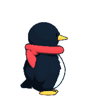

<p align="center">
  
</p>

<h1 align="center">Higher Ground</h1>

<p align="center">
  <b>Bilingual 2.5D Climate Awareness Adventure Platformer</b><br>
  <i>İki Dilli 2.5D İklim Farkındalığı Macera Platform Oyunu</i>
</p>

<p align="center">
  <a href="#english">English</a> • <a href="#türkçe">Türkçe</a>
</p>

---

## English

### About the Game
**Higher Ground** is a bilingual (English / Turkish) 2.5D climate adventure platformer built with Godot Engine 4.
Players guide a brave emperor penguin whose colony is threatened by record Antarctic sea-ice loss. Journey across perilous ice floes, slide down steep slopes, seek shelter from extreme heat, collect and correctly sort recyclable waste (paper, plastic, glass), rescue trapped chicks, and make critical climate choices to restore planetary hope.

### Controls
| Action | Key / Input |
|---|---|
| Move Left / Right | `A` / `D` or `Left` / `Right Arrow` |
| Jump | `Space` or `W` or `Up Arrow` |
| Belly Slide | `Shift` |
| Interact / Collect / Sort | `E` |
| Pause / Menu | `Esc` |
| Switch Language | `L` (Toggles English / Türkçe) |

### How to Play on Windows & macOS

- **Engine Version:** Godot Engine 4.x (compatible with Godot 4.3+ and 4.7+).

#### Option 1: One-Click Launchers (Zero Install Required)
- **Windows:**
  Double-click `run_windows.bat` in the project folder.
  *(If Godot is not installed, it automatically downloads the portable runner and launches the game).*
- **macOS / Linux:**
  Open Terminal in the game directory and run:
  ```bash
  ./run_mac.sh
  ```
  *(Automatically detects Godot or downloads the portable runner on demand).*

#### Option 2: Running via Godot Editor
1. Download Godot Engine 4 from [godotengine.org](https://godotengine.org/download/).
2. Open Godot, click **Import**, select `project.godot` inside this folder, then click **Import & Edit**.
3. Press **F5** (or click the Play icon in the top right corner) to start from the main menu (`res://features/ui/main_menu.tscn`).

#### Option 3: Terminal Run
```bash
godot --path .
```

### Credits & Asset Licenses
All assets in this project are original and license-safe. A complete breakdown is documented in [`docs/ASSET_LICENSES.md`](docs/ASSET_LICENSES.md).
- **Author:** Berkan Öksüz
- **Engine:** Godot Engine 4 (MIT License)
- **3D Models:** Original low-poly models created in Blender (CC0 Original).
- **Audio & Sound Effects:** Original sound effects and calm ambient music synthesized with Python (CC0 Original).
- **Scientific References:** Climate facts and data derived from UN, IPCC, NOAA, and British Antarctic Survey (BAS) reports.

---

## Türkçe

### Oyun Hakkında
**Higher Ground: İklim Yolculuğu**, Godot Engine 4 ile geliştirilmiş iki dilli (Türkçe / İngilizce) 2.5D iklim farkındalığı macera platform oyunudur.
Antarktika'da deniz buzlarının erimesiyle kolonisi tehlikeye giren bir imparator penguenine rehberlik ediyoruz. Zorlu buz vadilerini aşın, göbek üzerinde dik yamaçlardan kayın, aşırı sıcaktan gölgelere sığının, doğaya bırakılmış atıkları (kağıt, plastik, cam) toplayıp doğru geri dönüşüm kutularına ayrıştırın, mahsur kalan yavruları kurtarın ve Gezegen Umut Skorunu yükselterek güvenli zirveye ulaşın.

### Kontroller
| Eylem | Tuş / Girdi |
|---|---|
| Sola / Sağa Hareket | `A` / `D` veya `Sol` / `Sağ Ok` |
| Zıplama | `Boşluk (Space)` veya `W` veya `Yukarı Ok` |
| Göbekte Kayma | `Shift` |
| Etkileşim / Toplama / Ayrıştırma | `E` |
| Duraklat / Menü | `Esc` |
| Dil Değiştir | `L` (Türkçe / İngilizce) |

### Mac ve Windows Üzerinde Nasıl Oynanır

- **Godot Sürümü:** Godot Engine 4.x (Godot 4.3+ ve 4.7+ ile tam uyumludur).

#### 1. Yöntem: Tek Tıkla Başlatıcılar (Kurulum Gerektirmez)
- **Windows:**
  Klasör içerisindeki `run_windows.bat` dosyasına çift tıklayın.
  *(Bilgisayarınızda Godot kurulu değilse, taşınabilir oyun motorunu otomatik olarak indirip oyunu hemen başlatır).*
- **macOS / Linux:**
  Terminali bu klasörde açıp şu komutu çalıştırın:
  ```bash
  ./run_mac.sh
  ```
  *(Sistemdeki Godot'yu kullanır veya taşınabilir sürümü otomatik indirir).*

#### 2. Yöntem: Godot Editörü ile Açma
1. [godotengine.org](https://godotengine.org/download/) adresinden Godot Engine 4'ü indirin.
2. Godot'yu açıp **İçe Aktar (Import)** butonuna tıklayın, bu klasördeki `project.godot` dosyasını seçip **İçe Aktar ve Düzenle (Import & Edit)** deyin.
3. Sağ üstteki Oynat butonuna veya **F5** tuşuna basarak oyunu ana menüden (`res://features/ui/main_menu.tscn`) başlatın.

#### 3. Yöntem: Terminal / Komut Satırı
```bash
godot --path .
```

### Kredi ve Lisans Özeti
Projeye ait tüm varlıklar özgün ve lisans güvencelidir. Varlıkların tam listesi [`docs/ASSET_LICENSES.md`](docs/ASSET_LICENSES.md) dosyasında mevcuttur.
- **Geliştirici:** Berkan Öksüz
- **Oyun Motoru:** Godot Engine 4 (MIT Lisansı)
- **3D Modeller:** Blender ile üretilmiş orijinal düşük poligonlu modeller (CC0 Özgün).
- **Müzik ve Ses Efektleri:** Python ile sentezlenmiş özgün ses efektleri ve sakin fon müziği (CC0 Özgün).
- **Bilimsel Veriler:** BM (UN), IPCC, NOAA ve British Antarctic Survey (BAS) raporlarına dayalı gerçek çevre verileri.
